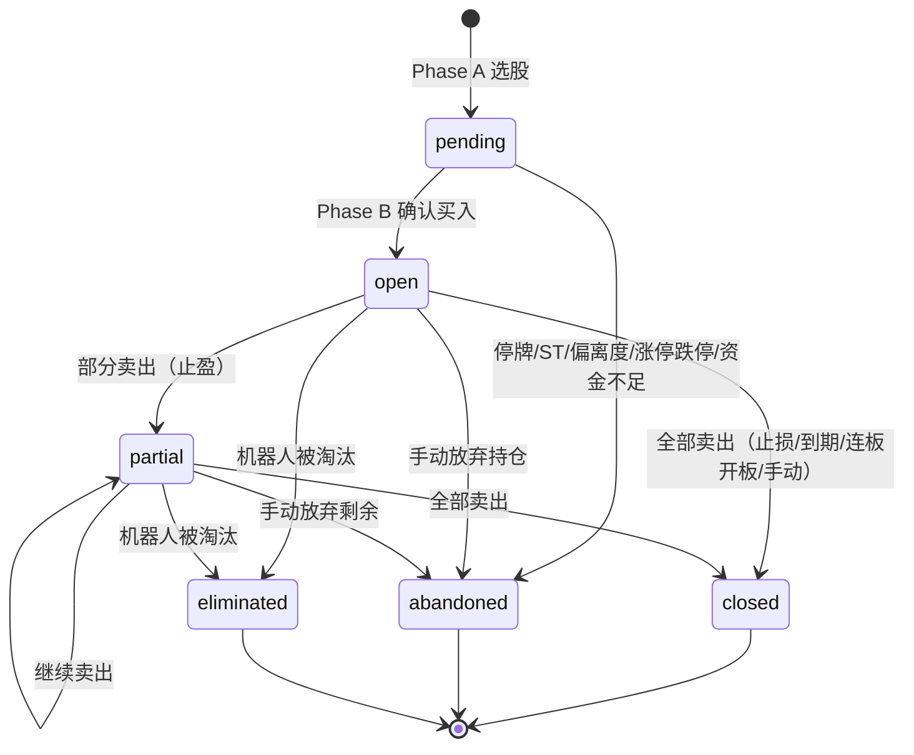
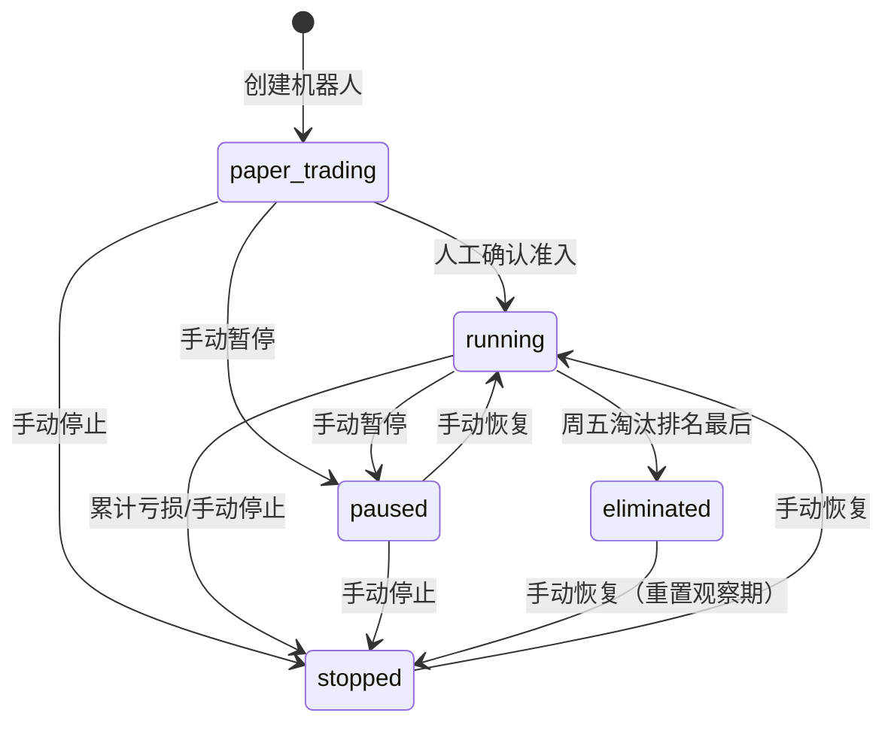
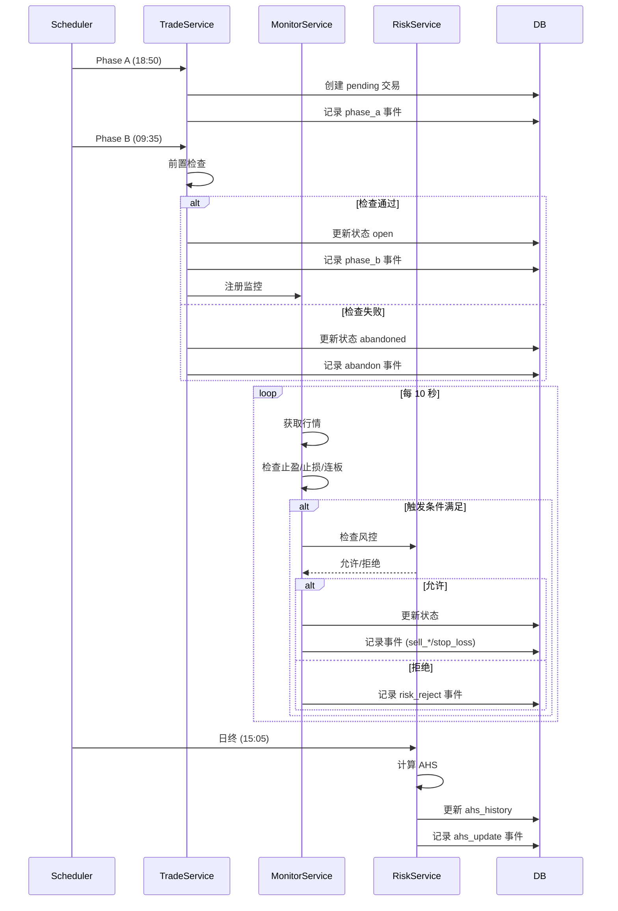
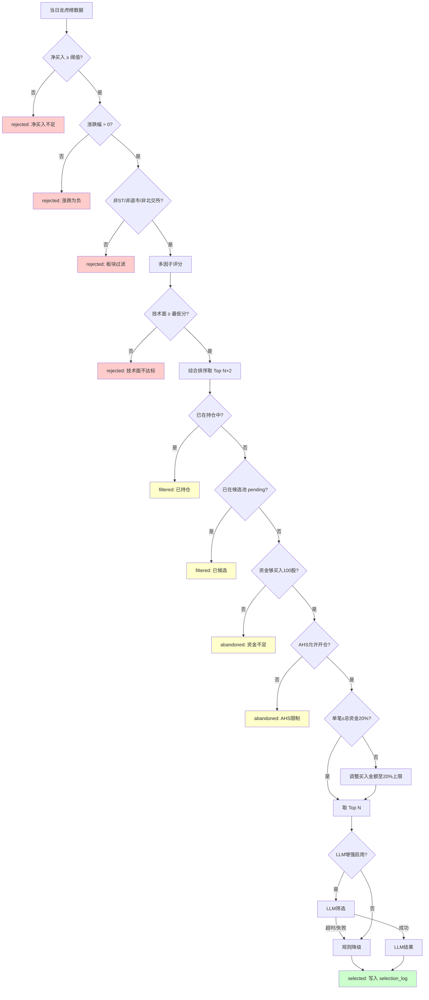

# 龙虎榜量化交易系统 v2 - 状态机定义

> 版本: 2.1.0
> 状态: 待实现
> 最后修订: 2025-04-16

---

## 评审建议采纳说明

> 二次评审修订日期: 2025-04-16

### 已采纳的改进项 ✅

| 评审问题 | 采纳的改进 |
|----------|------------|
| 交易状态缺少 eliminated 和部分转换路径 | 补充 eliminated 状态，添加 open→abandoned/eliminated、partial→abandoned/eliminated 转换 |
| 机器人状态机 stopped→eliminated 自矛盾 | 修正为禁止路径，明确淘汰只从 running 触发 |
| 字段定义与 DATABASE.md 大量不一致 | 改为引用 DATABASE.md，不重复定义字段 |
| partial 自转换语义不清 | 补充说明：通过 executions 和 events 追踪进度 |
| 事件类型拼写错误 + 与 DB 不一致 | 统一为 ahs_update（修正 ahp），补充完整枚举 |
| 选股流程缺少多个检查步骤 | 补充完整流程图（板块过滤、技术面检查、硬限制、LLM） |
| 一致性校验 SQL 不充分 | 补充 6 项关键校验 |
| AHS 阈值与 RISK_CONTROL.md 不一致 | 改为引用配置参数 |

### 不采纳的建议及原因 ❌

_暂无_

---

## 一、交易状态机

> 字段定义详见 [DATABASE.md - robot_trades 表](./DATABASE.md#机器人配置表)

### 1.1 状态定义

| 状态 | 说明 | 可转换到 |
|------|------|----------|
| `pending` | 预买入（Phase A 选股后） | `open`, `abandoned` |
| `open` | 持仓中 | `partial`, `closed`, `abandoned`, `eliminated` |
| `partial` | 部分卖出 | `partial`, `closed`, `abandoned`, `eliminated` |
| `closed` | 已结束（终态） | - |
| `abandoned` | 已放弃（终态） | - |
| `eliminated` | 机器人淘汰时强制关闭（终态） | - |

### 1.2 状态转换图



### 1.3 转换边定义

| # | 当前状态 | 目标状态 | 触发条件 | 副作用 |
|---|----------|----------|----------|--------|
| 1 | pending | open | Phase B 前置检查通过，执行买入 | 扣除现金，记录 buy_price/buy_shares |
| 2 | pending | abandoned | 停牌检测 = true | 记录 sell_reason |
| 3 | pending | abandoned | ST 检测 = true | 记录 sell_reason |
| 4 | pending | abandoned | 开盘价偏离度 > 5% | 记录 sell_reason |
| 5 | pending | abandoned | 涨停/跌停 | 记录 sell_reason |
| 6 | pending | abandoned | 资金不足（< 100股） | 记录 sell_reason |
| 7 | open | partial | 触发第一档止盈 sell_1 | 记录 sell_price/shares，写入 executions |
| 8 | open | partial | 触发第二档止盈 sell_2 | 同上 |
| 9 | open | partial | 触发第三档止盈 sell_3 | 同上 |
| 10 | open | closed | 触发止损 stop_loss | 记录最终 sell_price，全部卖出 |
| 11 | open | closed | 持仓到期 expire | 同上 |
| 12 | open | closed | 连板开板 lianban_open | 同上 |
| 13 | open | closed | 手动卖出 manual | 同上 |
| 14 | open | closed | 结算强制平仓（异常情况） | 同上 |
| 15 | open | abandoned | 手动放弃持仓 | 以当前价平仓 |
| 16 | open | eliminated | 机器人被淘汰 | 以当前价强制平仓 |
| 17 | partial | partial | 继续触发止盈 | 累加卖出数量，写入 executions |
| 18 | partial | closed | 最后剩余部分卖出 | 状态变更 |
| 19 | partial | abandoned | 手动放弃剩余持仓 | 以当前价平仓 |
| 20 | partial | eliminated | 机器人被淘汰 | 以当前价强制平仓 |

### 1.4 partial 状态说明

- `partial` 表示"已部分卖出，仍有持仓"
- `partial → partial` 自转换代表继续卖出一部分
- 自转换不触发状态机校验（因为 status 值未变）
- 卖出进度通过以下方式追踪：
  1. **trade_executions**：每次卖出一条记录（execution_type = sell_1/sell_2/sell_3）
  2. **trade_events**：每次卖出一条事件记录
  3. **robot_trades.sell_shares**：累计已卖出股数
- `partial → closed` 的判定条件：**剩余持仓 = 0**（sell_shares = buy_shares）

### 1.5 状态相关字段（引用）

> 完整字段定义见 [DATABASE.md - robot_trades](./DATABASE.md#交易主表)

状态机关注的核心字段：
- `robot_trades.status`: 交易状态（pending/open/partial/closed/abandoned/eliminated）
- `robot_trades.sell_reason`: 卖出/放弃原因（VARCHAR(50)）

---

## 二、机器人状态机

> 字段定义详见 [DATABASE.md - robots 表](./DATABASE.md#机器人配置表)

### 2.1 状态定义

| 状态 | 说明 | 可转换到 |
|------|------|----------|
| `paper_trading` | 模拟盘 | `running`, `paused`, `stopped` |
| `running` | 运行中 | `paused`, `stopped`, `eliminated` |
| `paused` | 已暂停 | `running`, `stopped` |
| `stopped` | 已停止（终态，可恢复） | `running` |
| `eliminated` | 已淘汰（终态，可恢复） | `stopped`（需先到 stopped） |

### 2.2 关键决策

1. **stopped → eliminated**: ❌ 禁止
   - 已停止的机器人不参与淘汰排名
   - 淘汰只从 running 状态触发

2. **paper_trading → running**: 需人工确认
   - 达标后系统发送飞书通知
   - 操作员确认后手动切换状态
   - 切换时清空模拟交易记录（或标记为 paper 阶段）

3. **eliminated → stopped → running**: 两步恢复
   - 淘汰后先恢复到 stopped
   - 人工确认后再切到 running
   - 恢复时重置观察期计数

### 2.3 状态转换图



### 2.4 转换边定义

| # | 当前状态 | 目标状态 | 触发条件 | 副作用 |
|---|----------|----------|----------|--------|
| 1 | - | paper_trading | 创建机器人 | 创建初始记录，设置初始资金 |
| 2 | paper_trading | running | 人工确认（运行≥20天 AND 胜率>50% AND 回撤<10% AND Sharpe>1.0） | 记录 running_start_date |
| 3 | paper_trading | paused | 手动暂停 | 停止选股和交易 |
| 4 | running | paused | 手动暂停 | 停止选股和交易 |
| 5 | paused | running | 手动恢复 | 恢复选股和交易 |
| 6 | running | stopped | 累计亏损 ≥ 20% 或手动停止 | 停止所有开仓 |
| 7 | paused | stopped | 手动停止 | 停止所有操作 |
| 8 | stopped | running | 手动恢复 | 恢复所有操作 |
| 9 | running | eliminated | 周五淘汰检查排名最后 | 强制平仓所有持仓 |
| 10 | eliminated | stopped | 手动恢复 | 重置观察期，需再确认才可 running |

### 2.6 状态字段（引用）

> 完整字段定义见 [DATABASE.md - robots](./DATABASE.md#机器人配置表)

状态机关注的核心字段：
- `robots.status`: 机器人状态
- `robots.mode`: 交易模式（paper_trading/live）

#### 存储字段（robots 表直接存储）

| 字段 | 说明 | 来源 |
|------|------|------|
| status | 机器人状态 | 直接存储 |
| mode | 交易模式 | 直接存储 |
| initial_capital | 初始资金 | 创建时设定 |
| cash_balance | 当前现金 | 交易时原子更新 |
| version | 乐观锁版本号 | 每次更新 +1 |

#### 计算字段（通过查询或视图获取）

| 字段 | 说明 | 计算方式 |
|------|------|----------|
| current_nav | 当前净值 | `v_robot_health.total_nav / initial_capital` |
| total_profit | 累计收益 | `SUM(realized_pnl) FROM robot_trades` |
| win_rate | 胜率 | `win_count / trade_count`（从 trades 聚合） |
| max_drawdown | 最大回撤 | 从 `daily_nav` 序列计算 |

---

## 三、交易事件状态机

### 3.1 统一事件类型枚举

> 需同步更新 [DATABASE.md - trade_events.event_type CHECK 约束](./DATABASE.md#交易事件表)

| 事件类型 | 说明 | 触发时机 |
|----------|------|----------|
| `phase_a` | Phase A 选股 | 18:50 |
| `phase_b` | Phase B 确认买入 | 09:35 |
| `sell_1` | 第一档止盈 | 盘中监控触发 |
| `sell_2` | 第二档止盈 | 盘中监控触发 |
| `sell_3` | 第三档止盈 | 盘中监控触发 |
| `stop_loss` | 止损触发 | 盘中监控触发 |
| `expire` | 持仓到期 | 到期日结算 |
| `lianban_open` | 连板开板 | 盘中监控触发 |
| `manual_buy` | 手动买入 | 人工操作 |
| `manual_sell` | 手动卖出 | 人工操作 |
| `abandon` | 放弃买入 | Phase B 检查失败 |
| `ahs_update` | AHS 评分更新 | 日终计算 |
| `circuit_break` | 熔断触发 | 风控事件 |
| `circuit_recover` | 熔断恢复 | 风控事件 |
| `risk_reject` | 硬限制拒绝 | 交易执行时 |
| `position_adjust` | 仓位调整 | AHS 变更后 |
| `monitor` | 常规监控记录 | 每 10 秒（仅异常时记录） |

### 3.2 事件流转时序图



---

## 四、选股决策状态机

### 4.1 决策类型定义

| 决策类型 | 说明 |
|----------|------|
| `selected` | 选中，进入候选池 |
| `rejected` | 拒绝，准入门槛未达标 |
| `filtered` | 过滤，评分后被其他股票挤出 |
| `abandoned` | 放弃，已持仓或风控限制 |

### 4.2 完整决策流程

> 流程参考 [RISK_CONTROL.md - 风控硬限制](./RISK_CONTROL.md#硬限制)



### 4.3 检查步骤说明

| 步骤 | 检查内容 | 参数来源 |
|------|----------|----------|
| 净买入阈值 | `net_buy_amount >= min_net_buy` | [PLAN.md strategy_params](./PLAN.md#策略参数) |
| 板块过滤 | `NOT IN (ST, 退市, 北交所)` | [RISK_CONTROL.md](./RISK_CONTROL.md#板块限制) |
| 技术面最低分 | `tech_score >= min_tech_score` | [PLAN.md strategy_params](./PLAN.md#策略参数) |
| AHS开仓限制 | `AHS < RISK_AHS_THRESHOLD_STOP` | [RISK_CONTROL.md](./RISK_CONTROL.md#仓位映射) |
| 单笔硬限制 | `单笔 ≤ 总资金 × 20%` | [RISK_CONTROL.md](./RISK_CONTROL.md#硬限制) |

---

## 五、状态机约束

### 5.1 非法转换拒绝

| 当前状态 | 尝试转换 | 结果 | 原因 |
|----------|----------|------|------|
| closed | → open | ❌ 拒绝 | 终态不可逆转 |
| closed | → partial | ❌ 拒绝 | 终态不可逆转 |
| abandoned | → open | ❌ 拒绝 | 终态不可逆转 |
| abandoned | → partial | ❌ 拒绝 | 终态不可逆转 |
| eliminated | → running | ❌ 拒绝 | 需先到 stopped |
| stopped | → eliminated | ❌ 拒绝 | 已停止的不参与淘汰 |

### 5.2 完整状态一致性校验 SQL

> 建议由日终对账任务自动执行，结果写入 health_check 表

```sql
-- ============================================================
-- 状态一致性校验（建议由日终对账任务自动执行）
-- ============================================================

-- 1. 交易状态与字段一致性
SELECT id, robot_id, stock_code, status, buy_price, buy_shares, sell_price,
       'open/partial without buy info' AS issue
FROM robot_trades 
WHERE status IN ('open', 'partial') 
  AND (buy_price IS NULL OR buy_shares IS NULL)
  AND deleted_at IS NULL

UNION ALL

SELECT id, robot_id, stock_code, status, buy_price, sell_price,
       'closed without sell info' AS issue
FROM robot_trades
WHERE status = 'closed'
  AND (buy_price IS NULL OR sell_price IS NULL)
  AND deleted_at IS NULL

UNION ALL

SELECT id, robot_id, stock_code, status, buy_price,
       'abandoned with buy executed' AS issue
FROM robot_trades
WHERE status = 'abandoned'
  AND buy_price IS NOT NULL
  AND deleted_at IS NULL;

-- 2. trade_executions 与 robot_trades 一致性
SELECT e.trade_id, e.execution_type, e.execution_amount,
       'execution without valid trade' AS issue
FROM trade_executions e
LEFT JOIN robot_trades t ON e.trade_id = t.id
WHERE t.id IS NULL OR t.deleted_at IS NOT NULL;

-- 3. partial 状态应有卖出记录
SELECT t.id, t.robot_id, t.stock_code, t.status,
       'partial without sell executions' AS issue
FROM robot_trades t
WHERE t.status = 'partial' AND t.deleted_at IS NULL
AND NOT EXISTS (
    SELECT 1 FROM trade_executions e
    WHERE e.trade_id = t.id 
    AND e.execution_type LIKE 'sell%'
);

-- 4. 现金余额对账（调用 DATABASE.md 中定义的对账函数）
SELECT r.id, r.name, r.cash_balance AS robot_cash,
       cl.balance_after AS ledger_cash,
       ABS(r.cash_balance - cl.balance_after) AS diff,
       'cash mismatch' AS issue
FROM robots r
LEFT JOIN LATERAL (
    SELECT balance_after FROM cash_ledger
    WHERE robot_id = r.id ORDER BY created_at DESC LIMIT 1
) cl ON TRUE
WHERE r.deleted_at IS NULL
  AND ABS(r.cash_balance - COALESCE(cl.balance_after, r.initial_capital)) > 0.01;

-- 5. 超期持仓未关闭
SELECT t.id, t.robot_id, t.stock_code, t.status, t.buy_date,
       CURRENT_DATE - t.buy_date AS actual_days,
       r.max_hold_days,
       'overdue position' AS issue
FROM robot_trades t
JOIN robots r ON t.robot_id = r.id
WHERE t.status IN ('open', 'partial')
  AND t.deleted_at IS NULL
  AND t.buy_date IS NOT NULL
  AND CURRENT_DATE - t.buy_date > r.max_hold_days;

-- 6. 机器人状态与AHS一致性
SELECT r.id, r.name, r.status AS robot_status,
       a.ahs_score, a.trading_mode,
       'running but AHS should stop' AS issue
FROM robots r
JOIN LATERAL (
    SELECT ahs_score, trading_mode FROM ahs_history
    WHERE robot_id = r.id ORDER BY score_date DESC LIMIT 1
) a ON TRUE
WHERE r.status = 'running'
  AND r.deleted_at IS NULL
  AND a.ahs_score > 80;
```

---

## 六、代码实现参考

### 6.1 状态机实现伪代码

> 详见 Phase 3 实现：`backend/app/services/state_machine.py`

```python
# backend/app/services/state_machine.py

TRADE_TRANSITIONS = {
    'pending':    ['open', 'abandoned'],
    'open':       ['partial', 'closed', 'abandoned', 'eliminated'],
    'partial':    ['partial', 'closed', 'abandoned', 'eliminated'],
    'closed':     [],     # 终态
    'abandoned':  [],     # 终态
    'eliminated': [],     # 终态
}

ROBOT_TRANSITIONS = {
    'paper_trading': ['running', 'paused', 'stopped'],
    'running':       ['paused', 'stopped', 'eliminated'],
    'paused':        ['running', 'stopped'],
    'stopped':       ['running'],          # 可恢复
    'eliminated':    ['stopped'],          # 只能先到 stopped
}

class InvalidStateTransition(Exception):
    """非法状态转换异常"""
    def __init__(self, current: str, target: str, allowed: list):
        self.current = current
        self.target = target
        self.allowed = allowed
        super().__init__(
            f"非法状态转换: {current} → {target}, "
            f"允许的目标: {allowed}"
        )

def validate_transition(
    current: str, 
    target: str, 
    transitions: dict
) -> bool:
    """验证状态转换是否合法"""
    if current == target:
        return True  # 自转换允许（如 partial → partial）
    allowed = transitions.get(current, [])
    if target not in allowed:
        raise InvalidStateTransition(current, target, allowed)
    return True

def transition_trade_status(
    session,
    trade_id: int,
    target_status: str,
    event_data: dict = None
) -> bool:
    """交易状态转换（含事件记录）"""
    from app.models.robot import RobotTrade
    from app.models.audit import TradeEvent
    
    trade = session.query(RobotTrade).get(trade_id)
    validate_transition(trade.status, target_status, TRADE_TRANSITIONS)
    
    old_status = trade.status
    trade.status = target_status
    
    # 记录状态变更事件
    event = TradeEvent(
        trade_id=trade_id,
        event_type=f"{old_status}_to_{target_status}",
        event_time=datetime.utcnow(),
        event_data=event_data or {}
    )
    session.add(event)
    session.commit()
    
    return True
```

### 6.2 状态机与文档同步机制

```yaml
## 文档与代码同步检查清单

1. DATABASE.md CHECK 约束更新时：
   - 同步更新 STATE_MACHINE.md 状态枚举
   - 同步更新 state_machine.py TRANSITIONS 字典

2. 新增状态转换路径时：
   - 更新 STATE_MACHINE.md 转换边表
   - 更新状态转换图（Mermaid）
   - 更新 state_machine.py TRANSITIONS
   - 添加对应的事件类型

3. CI 自动化校验建议：
   - 检查 STATE_MACHINE.md 中的转换边是否与代码一致
   - 检查非法转换表是否与 TRANSITIONS 冲突
```

---

## 七、版本历史

| 版本 | 日期 | 修改内容 |
|------|------|----------|
| 1.0.0 | 2025-04-01 | 初始版本 |
| 2.0.0 | 2025-04-16 | 补充 eliminated 状态，修正机器人状态机 |
| 2.1.0 | 2025-04-16 | 评审修订：统一事件枚举，完善选股流程，补充校验 SQL，添加代码参考 |
