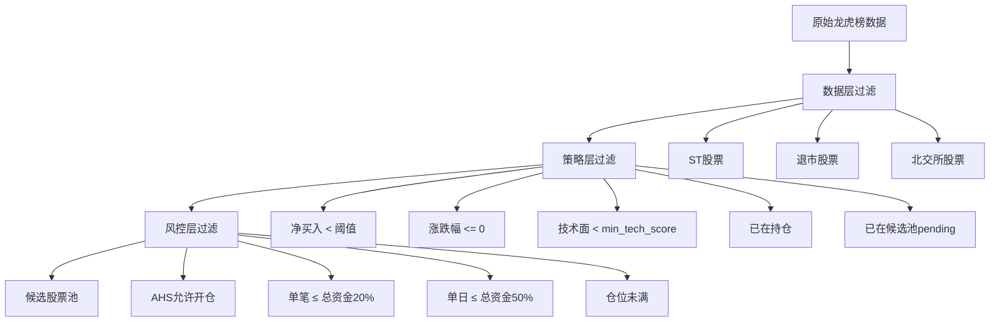

# 龙虎榜量化交易系统 v2 - 策略设计文档

> 版本: 2.1.0
> 状态: 待实现
> 最后修订: 2025-04-16

---

## 评审建议采纳说明

> 二次评审修订日期: 2025-04-16

### 已采纳的改进项 ✅

| 评审问题 | 采纳的改进 |
|----------|------------|
| 评分阶梯断裂+方向性问题 | 改为连续评分函数，修正涨停降分、换手率钟形分布 |
| 因子相关性已识别但未处理 | 补充相关性管理策略，初期标记为待优化 |
| 历史面数据依赖不存在 | 补充样本量分级收缩机制和数据回填计划 |
| 止盈止损执行逻辑缺陷 | 补充多档同时触发、优先级、零股处理定义 |
| 仓位计算不精确 | 补充术语定义表和精确计算步骤 |
| 选股条件与风控重叠 | 明确三层过滤职责分层 |
| 连板判定粗糙 | 改用实际涨停价比较，区分板块 |
| 费用模型不完整 | 修正印花税为万2.5，补充佣金最低5元 |
| 评分阈值需回测 | 补充回测验证计划 |
| 参数交叉校验缺失 | 补充校验规则和校验函数 |
| 文档交叉引用缺失 | 补充与其他文档的引用关系表 |

### 不采纳的建议及原因 ❌

_暂无_

---

## 一、策略概述

### 1.1 策略名称

**龙虎榜多因子策略 (LHB Multi-Factor Strategy)**

### 1.2 策略目标

- 捕捉龙虎榜个股的短期超额收益
- 通过量化评分筛选高胜率标的
- 严格止损，控制单笔亏损

### 1.3 核心假设

1. **龙虎榜信号有效性**: 上榜股票在 T+1 日有大概率正向波动
2. **资金面领先性**: 大资金买入的股票短期内表现更优
3. **席位溢价**: 知名游资/机构席位的买入信号更强

---

## 二、评分体系

### 2.1 评分公式

总分 = 技术面得分 × 40% + 资金面得分 × 35% + 历史面得分 × 25%

```
final_score = tech_score × 0.40 + fund_score × 0.35 + hist_score × 0.25
```

> 权重可通过 `strategy_params` 表调整，但必须满足 `tech + fund + hist = 1.0`

### 2.2 技术面评分 (40%)

#### 连续评分函数

```python
import math

def score_change_pct(change_pct: float) -> float:
    """
    涨跌幅评分（连续函数）
    
    核心假设修正：适度上涨（3%-7%）最优，涨停板反而降分
    
    Args:
        change_pct: 涨跌幅，如 0.05 表示 +5%
    
    Returns:
        0-100 分
    """
    if change_pct <= 0:
        return 20
    elif change_pct <= 0.03:
        # 0% → 40分，3% → 70分，线性插值
        return 40 + (change_pct / 0.03) * 30
    elif change_pct <= 0.07:
        # 3% → 70分，7% → 100分
        return 70 + ((change_pct - 0.03) / 0.04) * 30
    elif change_pct <= 0.10:
        # 7% → 100分，涨停 → 80分（涨停板降分）
        return 100 - ((change_pct - 0.07) / 0.03) * 20
    else:
        return 80  # 涨停板

def score_turnover(turnover_rate: float) -> float:
    """
    换手率评分（钟形分布）
    
    核心假设修正：适度换手最优（10%-20%），过高和过低都不是好信号
    
    Args:
        turnover_rate: 换手率，如 0.15 表示 15%
    
    Returns:
        0-100 分
    """
    optimal = 0.15  # 最优换手率 15%
    sigma = 0.10    # 标准差
    # 高斯钟形函数
    score = 100 * math.exp(-((turnover_rate - optimal) ** 2) / (2 * sigma ** 2))
    return max(20, score)

def score_lhb_count(lhb_count: int) -> float:
    """
    龙虎榜次数评分
    
    假设：适度上榜（3-5次）最优，频繁上榜可能被主力做盘
    """
    if lhb_count == 0:
        return 30
    elif lhb_count <= 2:
        return 50 + lhb_count * 10  # 1次=60，2次=70
    elif lhb_count <= 5:
        return 70 + (lhb_count - 2) * 10  # 3次=80，5次=100
    else:
        return max(60, 100 - (lhb_count - 5) * 5)  # 过多降分

def score_concentration(top1_ratio: float) -> float:
    """
    席位集中度评分
    
    假设修正：需要区分"谁在集中"
    - 知名游资/机构集中 = 好（高分）
    - 散户集中 = 差（低分）
    
    由于当前无法区分席位身份，暂用保守策略：
    - 过度集中（>60%）风险较高 → 降分
    - 适度集中（30%-50%）较优
    """
    if top1_ratio <= 0.20:
        return 60  # 过于分散，信号不明确
    elif top1_ratio <= 0.40:
        return 100  # 适度集中，最优区间
    elif top1_ratio <= 0.60:
        return 80  # 略高，仍有信号
    else:
        return 50  # 过度集中，风险高
```

#### 技术面计算公式

```
tech_score = change_score × 0.30 
           + turnover_score × 0.25
           + lhb_count_score × 0.25
           + concentration_score × 0.20
```

**归一化**: 所有得分归一化到 0-100 分

#### 数据来源

> 详见 [DATABASE.md](./DATABASE.md#龙虎榜相关表)

| 因子 | 数据表 | 字段 |
|------|--------|------|
| 涨跌幅 | `lhb_stock_daily` | `change_ratio` |
| 换手率 | `lhb_stock_daily` | `turnover_rate` |
| 龙虎榜次数 | `lhb_stock_daily` | 近30日 COUNT |
| 席位集中度 | `lhb_seats` | 计算 `top1_amount / SUM(buy_amount)` |

---

### 2.3 资金面评分 (35%)

#### 连续评分函数

```python
def score_net_buy(net_buy: float) -> float:
    """
    净买入额评分（对数函数）
    
    使用对数函数消除断裂，金额越大增长越慢
    
    Args:
        net_buy: 净买入额（元）
    
    Returns:
        0-100 分
    """
    if net_buy <= 0:
        return 0
    # 1000万=40分，5000万=60分，1亿=80分，2亿=100分
    score = 20 * math.log10(net_buy / 1_000_000)
    return max(0, min(100, score))

def score_institution_ratio(institution_ratio: float) -> float:
    """
    机构买入占比评分（连续函数）
    """
    if institution_ratio <= 0:
        return 30
    elif institution_ratio <= 0.30:
        return 30 + (institution_ratio / 0.30) * 30  # 0-30%: 30-60分
    elif institution_ratio <= 0.50:
        return 60 + ((institution_ratio - 0.30) / 0.20) * 20  # 30-50%: 60-80分
    else:
        return 80 + min(20, (institution_ratio - 0.50) * 40)  # >50%: 80-100分
```

#### 资金面计算公式

```
fund_score = net_buy_score × 0.45
           + institution_score × 0.30
           + seat_type_score × 0.25
```

#### 席位类型评分

```python
def score_seat_type(seat_tags: list) -> float:
    """
    席位类型评分
    
    Args:
        seat_tags: 席位标签列表，如 ["机构专用", "知名游资"]
    
    Returns:
        50-100 分
    """
    if "知名游资" in seat_tags:
        return 100
    elif "机构专用" in seat_tags:
        return 85
    elif "沪股通" in seat_tags or "深股通" in seat_tags:
        return 75
    else:
        return 50  # 普通席位
```

#### 数据来源

| 因子 | 数据表 | 字段 |
|------|--------|------|
| 净买入额 | `lhb_seats` | `SUM(amount WHERE direction='buy') - SUM(amount WHERE direction='sell')` |
| 机构买入占比 | `lhb_seats` | `SUM(amount WHERE seat_type='institution') / SUM(amount WHERE direction='buy')` |
| 席位类型 | `lhb_seats` | `seat_type`, `seat_tags` |

---

### 2.4 历史面评分 (25%)

#### 样本量收缩机制

> 解决冷启动问题：新系统/新股票历史面数据为空

```python
def calc_hist_score_with_shrinkage(stock_code: str, lookback: int = 20) -> float:
    """
    历史面评分（带样本量收缩）
    
    Args:
        stock_code: 股票代码
        lookback: 回看样本数
    
    Returns:
        0-100 分
    """
    raw_score = calc_raw_hist_score(stock_code, lookback)
    sample_count = get_sample_count(stock_code)
    
    # 收缩公式
    neutral = 50
    confidence = min(1.0, sample_count / 20)  # 20个样本完全信任
    
    # 分级收缩
    if sample_count == 0:
        confidence = 0.0
    elif sample_count < 5:
        confidence = sample_count / 20 * 0.3  # 最大0.15（收缩85%）
    elif sample_count < 10:
        confidence = 0.15 + (sample_count - 5) / 5 * 0.25  # 0.15-0.40
    elif sample_count < 20:
        confidence = 0.40 + (sample_count - 10) / 10 * 0.40  # 0.40-0.80
    
    shrunk_score = neutral + (raw_score - neutral) * confidence
    return shrunk_score
```

| 样本数 | 置信度 | 处理方式 |
|--------|--------|----------|
| 0 次 | 0% | 历史面得分 = 50（中性值，不惩罚不奖励） |
| 1-4 次 | ≤15% | 向中性值收缩 85% |
| 5-9 次 | 15%-40% | 向中性值收缩 60% |
| 10-19 次 | 40%-80% | 向中性值收缩 20% |
| ≥20 次 | 100% | 完全信任实际计算值 |

#### 历史面计算公式

```
hist_score = t1_win_rate_score × 0.40
           + t1_avg_return_score × 0.35
           + max_gain_score × 0.25
```

#### 数据来源

| 因子 | 数据表 | 计算方式 |
|------|--------|----------|
| T+1 胜率 | `lhb_tn_prices` | 近20次上榜中 `close_ret > 0` 的比例 |
| T+1 平均收益 | `lhb_tn_prices` | 近20次 `AVG(close_ret)` |
| 最大涨幅 | `lhb_tn_prices` | 近20次 `MAX(high_ret)` |

#### 数据回填计划

> Phase 2 数据层开发优先级

```
优先级 1: 近3个月龙虎榜数据 → lhb_stock_daily
优先级 2: 近1年K线数据 → kline_daily
优先级 3: 计算 T+N 价格 → lhb_tn_prices
```

---

### 2.5 因子相关性管理

#### 已识别的高相关因子对

| 因子对 | 预估相关系数 | 影响 |
|--------|-------------|------|
| 涨跌幅(tech) ↔ 净买入额(fund) | > 0.7 | 资金维度被过度加权 |
| 换手率(tech) ↔ 净买入额(fund) | > 0.6 | 类似问题 |
| 龙虎榜次数(tech) ↔ T+1胜率(hist) | > 0.5 | 间接关联 |

#### 相关性管理策略

```yaml
## 上线前
- 使用近1年龙虎榜数据计算因子相关矩阵
- 如果相关系数 > 0.7，考虑合并或降权其中一个因子

## 上线后
- 每月计算一次因子相关性
- 监控指标：IC（Information Coefficient）
- 如果某因子 IC 连续3月 < 0.02，考虑替换

## 初期简化处理
factor_correlations_check_enabled: false  # 初期不启用去相关
# 先让系统跑起来，收集数据后再优化
```

---

## 三、选股条件

### 3.1 过滤职责分层

> 明确各层职责，避免重复和遗漏



### 3.2 数据层过滤

> 在 `data_providers` 层获取数据时就排除

| 过滤项 | 数据来源 | 配置方式 |
|--------|----------|----------|
| ST 股票 | `stock_info.is_st = true` | 固定过滤 |
| 退市股票 | `stock_info.is_active = false` | 固定过滤 |
| 北交所股票 | `stock_info.board_type = 'bse'` | 可配置开关 |

### 3.3 策略层过滤

> 在 `scorer.py` 评分前过滤

| 过滤项 | 条件 | 配置参数 |
|--------|------|----------|
| 净买入额 | `< min_net_buy` | `strategy_params.min_net_buy` |
| 涨跌幅 | `≤ 0` | 硬编码 |
| 技术面得分 | `< min_tech_score` | `strategy_params.min_tech_score` |
| 已在持仓 | `status IN (open, partial)` | 查询 `robot_trades` |
| 已在候选池 | `status = pending` | 查询 `selection_log` |

### 3.4 风控层过滤

> 在 `risk_service.py` 评分后过滤

> 详见 [RISK_CONTROL.md - 硬限制](./RISK_CONTROL.md#硬限制)

| 过滤项 | 条件 | 配置来源 |
|--------|------|----------|
| AHS 开仓限制 | `AHS >= RISK_AHS_THRESHOLD_STOP` | `RISK_CONTROL.md` 定义为 81 |
| 单笔上限 | `单笔 > 总资产 × 20%` | 系统硬限制 |
| 单日上限 | `当日累计 > 总资产 × 50%` | 系统硬限制 |
| 仓位已满 | `当前持仓数 >= max_positions` | `robots.max_positions` |

---

## 四、止损止盈策略

### 4.1 止损规则

```python
def check_stop_loss(trade, current_price):
    """
    止损检查
    
    触发条件: 当前价格 ≤ 买入价格 × (1 + stop_loss_pct)
    执行: 卖出剩余全部持仓
    
    Returns:
        (triggered: bool, sell_shares: int)
    """
    stop_price = trade.buy_price * (1 + trade.stop_loss_pct)
    if current_price <= stop_price:
        # 卖出剩余全部（不是初始全部）
        remaining = get_remaining_shares(trade.id)
        return True, remaining
    return False, 0
```

### 4.2 止盈规则（精确定义）

#### 基数定义

> **关键**：所有卖出比例以"初始买入数量"为基数

```python
# 初始买入 1000 股
initial_shares = 1000

# sell_1: 卖出 floor(初始数量 × 0.33 / 100) × 100 = 300 股
sell_1_shares = floor(initial_shares * 0.33 / 100) * 100

# sell_2: 卖出 floor(初始数量 × 0.33 / 100) × 100 = 300 股
sell_2_shares = floor(initial_shares * 0.33 / 100) * 100

# sell_3: 卖出剩余全部（含零股）
sell_3_shares = initial_shares - sell_1_shares - sell_2_shares  # = 400 股
```

#### 多档同时触发处理

```python
def execute_take_profit(trade, current_price, thresholds):
    """
    止盈执行（处理多档同时触发）
    
    Args:
        trade: 交易记录
        current_price: 当前价格
        thresholds: 止盈阈值列表 [(sell_1_pct, sell_1_ratio), ...]
    
    Returns:
        List[Execution]: 执行记录列表
    """
    executions = []
    
    # 按档位顺序检查
    for i, (pct, ratio) in enumerate(thresholds):
        threshold_price = trade.buy_price * (1 + pct)
        
        if current_price >= threshold_price:
            # 检查该档位是否已执行
            if not is_sell_executed(trade.id, i + 1):
                # 计算卖出数量（基于初始数量）
                shares = calc_sell_shares(trade.initial_shares, ratio)
                
                # 如果已执行 sell_1/sell_2，剩余数量可能不足
                remaining = get_remaining_shares(trade.id)
                actual_shares = min(shares, remaining)
                
                if actual_shares > 0:
                    executions.append(create_execution(
                        trade_id=trade.id,
                        execution_type=f'sell_{i + 1}',
                        shares=actual_shares,
                        price=current_price
                    ))
    
    # 如果一次监控周期内价格已超过 sell_3 阈值
    # → 直接全部卖出（优化路径，减少分笔）
    if current_price >= trade.buy_price * (1 + thresholds[2][0]):
        # 跳过 sell_1/sell_2，直接一条 sell_3 记录
        # 但需要标记 sell_1_done 和 sell_2_done 为已跳过
        pass
    
    return executions
```

#### 止损与止盈优先级

```python
def check_sell_conditions(trade, current_price):
    """
    卖出条件检查（含优先级）
    
    优先级: 止损 > 止盈 > 到期 > 连板开板
    """
    # 1. 止损优先级最高
    triggered, shares = check_stop_loss(trade, current_price)
    if triggered:
        return 'stop_loss', shares
    
    # 2. 止盈（如果同时触发多档，按顺序执行）
    for i, (pct, ratio) in enumerate(trade.take_profit_tiers):
        if current_price >= trade.buy_price * (1 + pct):
            if not is_sell_executed(trade.id, i + 1):
                return f'sell_{i + 1}', calc_sell_shares(trade.initial_shares, ratio)
    
    # 3. 持仓到期
    if trade.hold_days >= trade.max_hold_days:
        return 'expire', get_remaining_shares(trade.id)
    
    # 4. 连板开板
    if is_lianban_opened(trade):
        return 'lianban_open', get_remaining_shares(trade.id)
    
    return None, 0
```

#### 零股处理

```python
def calc_sell_shares(initial_shares: int, ratio: float) -> int:
    """
    计算卖出数量（处理零股）
    
    规则：
    - sell_1/sell_2：向下取整到100股
    - sell_3：剩余全部（含零股）
    """
    raw_shares = initial_shares * ratio
    
    # 向下取整到整手
    rounded_shares = floor(raw_shares / 100) * 100
    
    return max(100, rounded_shares)  # 最少100股
```

#### 计算示例

```
买入1000股，买入价10元

sell_1 (3%): 价格≥10.3 → 卖出 floor(1000×0.33/100)×100 = 300股 → 剩余700股
sell_2 (5%): 价格≥10.5 → 卖出 floor(1000×0.33/100)×100 = 300股 → 剩余400股
sell_3 (8%): 价格≥10.8 → 卖出400股（含零股）→ 剩余0股 → closed

止损 (-5%): 价格≤9.5 → 卖出剩余全部
```

### 4.3 持仓期限

```python
def check_expire(trade, trade_date):
    """
    持仓到期检查
    
    触发条件: 持仓天数 >= max_hold_days
    执行: 全部卖出（无论盈亏）
    
    注意：max_hold_days 在本版本修正为 5 天（与 PLAN.md 一致）
    """
    hold_days = trade_date - trade.buy_date
    if hold_days >= trade.max_hold_days:
        return True, get_remaining_shares(trade.id)
    return False, 0
```

### 4.4 连板规则（修订版）

#### 涨停价计算

```python
def calc_limit_up_price(prev_close: float, board_type: str) -> float:
    """
    计算实际涨停价
    
    区分不同板块：
    - 主板/中小板：10%
    - 科创板/创业板：20%
    - ST：5%
    
    注意：北交所已在数据层过滤，不参与
    """
    if board_type == 'star' or board_type == 'gem':
        multiplier = 1.20
    elif board_type == 'st':
        multiplier = 1.05
    else:
        multiplier = 1.10
    
    # 涨停价精确到分（A股规则）
    return round(prev_close * multiplier, 2)
```

#### 涨停判断

```python
def is_limit_up(current_price: float, limit_up_price: float) -> bool:
    """
    涨停判断（使用实际涨停价，而非涨跌幅阈值）
    
    Args:
        current_price: 当前价格
        limit_up_price: 实际涨停价（从数据源或计算得出）
    
    Returns:
        是否涨停
    """
    # 允许 0.01 元误差（价格精度）
    return current_price >= limit_up_price - 0.01
```

#### 开板判断

```python
def is_lianban_opened(trade, current_price, limit_up_price, high_today):
    """
    连板开板判断
    
    开板条件：
    1. 盘中曾触及涨停（high_today >= limit_up_price）
    2. 当前价格偏离涨停价 ≥2%
    
    Returns:
        (opened: bool, reason: str)
    """
    # 检查是否连续涨停
    if trade.lianban_days < 2:
        return False, None
    
    # 检查是否曾触及涨停
    if high_today < limit_up_price:
        return False, None
    
    # 检查是否开板（当前价格低于涨停价2%）
    if current_price < limit_up_price * 0.98:
        return True, f'连板{trade.lianban_days}天后开板，当前价{current_price}'
    
    return False, None
```

#### 数据来源

| 数据 | 来源 | 字段 |
|------|------|------|
| 涨停价 | 实时行情 | `limit_up`（数据源直接提供，优先使用） |
| 前收盘价 | K线 | `kline_daily.prev_close` |
| 板块类型 | 股票信息 | `stock_info.board_type` |
| 当日最高 | 实时行情 | `high_price` |
| 当前价格 | 实时行情 | `current_price` |

---

## 五、仓位管理

### 5.1 术语定义

| 术语 | 定义 | 来源 |
|------|------|------|
| 总资产 | `cash_balance + 持仓市值` | `robots` 表计算 |
| 可用资金 | `cash_balance - pending_frozen` | `robots.cash_balance` |
| pending_frozen | `pending` 状态交易的预估买入金额总和 | `robot_trades` 计算 |
| 当前持仓数 | `COUNT(status IN (open, partial))` | `robot_trades` |
| pending 数 | `COUNT(status = pending)` | `robot_trades` |
| 剩余可开仓数 | `max_positions - 当前持仓数 - pending数` | `robots.max_positions` |

### 5.2 单笔买入金额计算

```python
def calc_buy_amount(robot_id: int, ahs_coefficient: float) -> float:
    """计算单笔买入金额"""
    robot = get_robot(robot_id)
    
    pending_frozen = calc_pending_frozen(robot_id)
    available = robot.cash_balance - pending_frozen
    if available <= 0:
        return 0
    
    available_after_fee = available * 0.99
    
    remaining_slots = robot.max_positions - count_open(robot_id) - count_pending(robot_id)
    if remaining_slots <= 0:
        return 0
    
    equal_share = available_after_fee / remaining_slots
    
    total_assets = robot.cash_balance + calc_position_value(robot_id)
    hard_limit = total_assets * 0.20
    ahs_limit = total_assets * ahs_coefficient * 0.20
    
    buy_amount = min(equal_share, hard_limit, ahs_limit)
    
    if buy_amount < 1000:
        return 0
    
    return buy_amount
```

### 5.3 最小交易单位

| 板块 | 最小买入 | 最小卖出 |
|------|----------|----------|
| 主板/中小板 | 100股 | 1股 |
| 科创板 | 200股 | 1股 |
| 创业板 | 100股 | 1股 |

---

## 六、费用计算

### 6.1 费用项

| 费用项 | 费率 | 约束 |
|--------|------|------|
| 佣金 | 万3 | 最低5元 |
| 印花税 | 万2.5 | 仅卖出 |
| 过户费 | 万0.1 | 双向 |
| 滑点 | 千1 | 估算 |

### 6.2 费用计算示例

```
买入：19890元
  佣金：max(5, 5.97) = 5.97元
  过户费：0.20元
  滑点：19.89元
  总成本：19916.06元

卖出：21450元
  佣金：6.44元
  印花税：5.36元
  过户费：0.21元
  滑点：21.45元
  净收入：21416.54元
```

---

## 七、策略参数表

### 7.1 可配置参数

| 参数名 | 默认值 | 范围 |
|--------|--------|------|
| `min_net_buy` | 5000万 | 1000万~2亿 |
| `min_tech_score` | 50 | 0~100 |
| `stop_loss_pct` | -0.05 | -0.20~-0.01 |
| `sell1_pct` | 0.03 | 0.01~0.50 |
| `sell2_pct` | 0.05 | sell1+0.01~0.50 |
| `sell3_pct` | 0.08 | sell2+0.01~0.50 |
| `max_hold_days` | 5 | 1~30 |
| `max_positions` | 3 | 1~10 |

### 7.2 权重参数

| 参数名 | 默认值 |
|--------|--------|
| `tech_weight` | 0.40 |
| `fund_weight` | 0.35 |
| `hist_weight` | 0.25 |

### 7.3 参数交叉校验规则

- 止盈递增：`sell1 < sell2 < sell3`
- 盈亏比：`sell1 >= abs(stop_loss) × 0.5`
- 权重和：`tech + fund + hist = 1.0`

---

## 八、回测验证计划

| 验证项 | 方法 | 指标 |
|--------|------|------|
| 阶梯阈值 | 分组回测 | 胜率差异 |
| 因子权重 | 网格搜索 | 夏普比率 |
| 止盈档位 | 对比测试 | 总收益 |
| 止损阈值 | 对比测试 | 最大回撤 |

---

## 九、风险提示

### 9.1 已知局限性

- 幸存者偏差：历史仅基于上榜股票
- 信号衰减：数据T+1公开
- 过拟合风险：参数历史优化

### 9.2 因子相关性监控

- 上线前计算因子相关矩阵
- 相关系数>0.7考虑合并或降权
- 上线后每月监控IC值

---

## 十、文档交叉引用

### 10.1 数据依赖

| 模块 | 数据表 | 文档 |
|------|--------|------|
| 技术面 | `lhb_stock_daily` | DATABASE.md |
| 资金面 | `lhb_seats` | DATABASE.md |
| 历史面 | `lhb_tn_prices` | DATABASE.md |

### 10.2 风控集成

| 行为 | 规则 | 文档 |
|------|------|------|
| 仓位系数 | AHS映射 | RISK_CONTROL.md |
| 单笔上限 | 20%硬限制 | RISK_CONTROL.md |

### 10.3 执行流程

| 阶段 | 时机 | 文档 |
|------|------|------|
| 评分选股 | 18:50 | TRADING_FLOW.md |
| 买入确认 | 09:35 | TRADING_FLOW.md |
| 止损止盈 | 盘中 | TRADING_FLOW.md |

---

## 十一、版本历史

| 版本 | 日期 | 修改内容 |
|------|------|----------|
| 1.0.0 | 2025-04-01 | 初始版本 |
| 2.0.0 | 2025-04-16 | 补充评分细节和参数表 |
| 2.1.0 | 2025-04-16 | 评审修订：连续评分函数、样本量收缩、止盈止损精确执行、仓位计算精确化、过滤职责分层、连板判定修订、费用模型修正、参数交叉校验、回测验证计划、文档交叉引用 |
