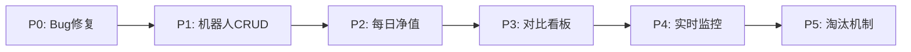

# 策略机器人平台开发指南

> **总指导文档** - 整合所有开发阶段的概览与依赖关系
>
> 🤖 **Agent 开发入口**：[AGENT_DEV_GUIDE.md](./AGENT_DEV_GUIDE.md) - 包含完整的 Agent Prompt 和阶段状态追踪

---

## 📋 开发阶段状态

| 阶段 | 文档 | 代码 | 验证 | 状态 | 完成时间 |
|------|------|------|------|------|----------|
| P0 | ✅ | ⬜ | ⬜ | ⬜ 未开始 | - |
| P1 | ✅ | ⬜ | ⬜ | ⬜ 未开始 | - |
| P2 | ✅ | ⬜ | ⬜ | ⬜ 未开始 | - |
| P3 | ✅ | ⬜ | ⬜ | ⬜ 未开始 | - |
| P4 | ✅ | ⬜ | ⬜ | ⬜ 未开始 | - |
| P5 | ✅ | ⬜ | ⬜ | ⬜ 未开始 | - |

### 状态说明
- ✅ 已完成
- 🔄 进行中
- ⬜ 未开始

---

## 项目定位

**一句话描述**：一个支持多策略、多机器人并行的模拟炒股平台，具备实时监控、自动止损、策略对比和机器人淘汰机制。

---

## 整体架构

```
┌─────────────────────────────────────────────────────┐
│                    前端页面 (Streamlit)                │
├──────────┬──────────┬───────────┬───────────────────┤
│ 模拟炒股  │ 机器人管理 │ 机器人对比  │ 策略对比看板      │
│(现有改造) │  (新增)   │   (新增)   │    (新增)         │
├──────────┴──────────┴───────────┴───────────────────┤
│                    后端服务层                          │
├────────┬─────────┬──────────┬───────────┬───────────┤
│Phase A │Phase B  │实时监控   │淘汰引擎    │净值计算    │
│盘后选股 │开盘买入  │盘中止损   │定期评分    │每日快照    │
│18:45   │09:35    │9:30-15:00│自动清仓    │15:05      │
├────────┴─────────┴──────────┴───────────┴───────────┤
│                    策略引擎                            │
├──────────┬──────────┬───────────┬───────────────────┤
│龙虎榜策略 │ 策略B    │  策略C     │  可插拔注册        │
│(已有)    │ (待开发)  │ (待开发)   │                   │
├──────────┴──────────┴───────────┴───────────────────┤
│                    数据层 (PostgreSQL)                 │
├──────────┬──────────┬───────────┬───────────────────┤
│sim_robots│sim_trades│cash_ledger│market_snapshots   │
│机器人表   │交易表    │现金流水    │行情快照(5min)     │
└──────────┴──────────┴───────────┴───────────────────┘
```

---

## 开发阶段总览

| 阶段 | 内容 | 文档 | 预计时间 | 状态 |
|------|------|------|----------|------|
| **P0** | Bug修复 + 交易成本体系 | [phase-P0-bugfix-and-cost.md](./phase-P0-bugfix-and-cost.md) | 1-2天 | 待开发 |
| **P1** | 机器人CRUD + 策略注册 | [phase-P1-robot-crud.md](./phase-P1-robot-crud.md) | 2-3天 | 待开发 |
| **P2** | 每日净值 + 净值曲线 | [phase-P2-daily-nav.md](./phase-P2-daily-nav.md) | 2天 | 待开发 |
| **P3** | 对比看板 + 评分体系 | [phase-P3-comparison-dashboard.md](./phase-P3-comparison-dashboard.md) | 2-3天 | 待开发 |
| **P4** | 实时监控 + 盘中止损 | [phase-P4-realtime-monitor.md](./phase-P4-realtime-monitor.md) | 3-5天 | 待开发 |
| **P5** | 淘汰机制 + 分批建仓 | [phase-P5-elimination.md](./phase-P5-elimination.md) | 3-5天 | 待开发 |

---

## 阶段依赖关系



**关键依赖**：
- P1 依赖 P0 的 `robot_id` 字段和交易成本计算
- P2 依赖 P1 的机器人管理和现金流水
- P3 依赖 P2 的每日净值数据
- P4 依赖 P1 的策略框架
- P5 依赖 P2-P3 的评分体系

---

## 核心参数

| 类别 | 参数 | 值 |
|------|------|-----|
| 印花税 | 卖出 | 0.05% |
| 佣金 | 买卖双向 | 万3（0.03%），最低5元 |
| 过户费 | 沪市 | 0.001%，深市免收 |
| 滑点 | 模拟 | 买入+0.1%，卖出-0.1% |
| 行情轮询 | 实时 | 每10秒（触发止损用） |
| 行情存储 | 入库 | 5分钟线（复盘用） |
| 复权 | 净值计算 | 前复权 |
| 分红 | 现金 | 计入机器人现金余额 |

---

## 数据库表总览（12张表）

| 表名 | 用途 | 创建阶段 |
|------|------|----------|
| `sim_robots` | 机器人管理 | P1 |
| `sim_trades` | 交易记录（+成本字段） | P0 |
| `sim_trade_events` | 交易事件（+成本字段） | P0 |
| `sim_selection_log` | 选股记录（+lianban_score） | P0 |
| `cash_ledger` | 现金流水 | P1 |
| `sim_daily_summary` | 每日净值快照 | P2 |
| `benchmark_daily` | 基准指数行情 | P2 |
| `market_snapshots` | 5分钟行情快照 | P4 |
| `monitor_events` | 监控触发事件 | P4 |
| `strategy_registry` | 策略注册表 | P1 |
| `score_weights_config` | 评分权重配置 | P3 |
| `elimination_records` | 淘汰历史记录 | P5 |
| `dividend_records` | 分红记录 | P5 |

---

## 每日运行时序

```
09:00  除权分红检查      dividend_handler
09:30  实时监控启动      realtime_monitor (supervisor)
09:35  Phase B 买入      trade_runner.run_phase_b
09:36  监控开始轮询      realtime_monitor (每10秒)
       ├── 实时行情获取
       ├── 止损/止盈检查 → 立即卖出
       ├── 分批建仓检查 → 加仓
       └── 每5分钟存行情快照
11:30  午休暂停轮询
13:00  恢复轮询
15:00  监控停止
15:05  每日结算          daily_settlement
       ├── 计算净值
       ├── 超期清仓
       ├── 拉取基准指数
       └── 淘汰检查       eliminator
18:45  Phase A 选股      trade_runner.run_phase_a
02:00  数据库备份        backup_db.sh
```

---

## 文件结构总览

```
skills/stock_sim_robot/
├── trade_cost.py              # P0: 交易成本计算
├── position_calc.py           # P0: 仓位计算
├── cash_manager.py            # P1: 现金余额管理
├── robot_manager.py           # P1: 机器人CRUD
├── strategy_base.py           # P1: 策略基类
├── strategy_loader.py          # P1: 策略动态加载
├── daily_settlement.py        # P2: 每日结算
├── scorer.py                  # P3: 机器人评分体系
├── charts.py                  # P3: 6个对比图表
├── realtime_monitor.py        # P4: 实时监控
├── eliminator.py              # P5: 淘汰引擎
├── dividend_handler.py        # P5: 除权分红处理
├── data_cleaner.py            # P5: 数据清理
└── modules/
    └── strategy_lianban.py    # P1: 龙虎榜策略（包装现有代码）

scripts/
├── migrate_p0.py
├── migrate_p1.py
├── migrate_p2.py
├── migrate_p3.py
├── migrate_p4.py
├── migrate_p5.py
├── daily_cron.py              # 统一调度入口
├── backup_db.sh               # 数据库备份
└── verify_p0.py               # P0 验证脚本
```

---

## 开发规范

### 1. 阶段验收标准

每个阶段完成后需满足：
- ✅ 数据库迁移脚本执行成功
- ✅ 验证脚本通过
- ✅ 前端页面正常渲染
- ✅ 部署到远程服务器验证

### 2. 代码规范

- 页面模块必须暴露 `render()` 函数
- 策略类必须继承 `BaseStrategy`
- 所有 SQL 使用参数化查询（防注入）
- 日志使用 `loguru`

### 3. Git 分支策略

```bash
# 每个阶段一个特性分支
git checkout -b feature/strategy-robot-p0
git checkout -b feature/strategy-robot-p1
# ...

# 完成后合并到 main
git checkout main
git merge feature/strategy-robot-p0
git push origin main
```

---

## 快速开始

### 1. 执行数据库迁移

```bash
ssh jd
cd ~/stock_analysis
python scripts/migrate_p0.py
python scripts/migrate_p1.py
# ... 按顺序执行
```

### 2. 配置 Crontab

```bash
crontab -e
# 添加以下内容（参考各阶段文档）
```

### 3. 启动监控进程

```bash
supervisorctl restart sim_monitor
```

---

## 相关文档

- [P0: Bug修复 + 交易成本体系](./phase-P0-bugfix-and-cost.md)
- [P1: 机器人CRUD + 策略注册](./phase-P1-robot-crud.md)
- [P2: 每日净值 + 净值曲线](./phase-P2-daily-nav.md)
- [P3: 对比看板 + 评分体系](./phase-P3-comparison-dashboard.md)
- [P4: 实时监控 + 盘中止损](./phase-P4-realtime-monitor.md)
- [P5: 淘汰机制 + 分批建仓](./phase-P5-elimination.md)
